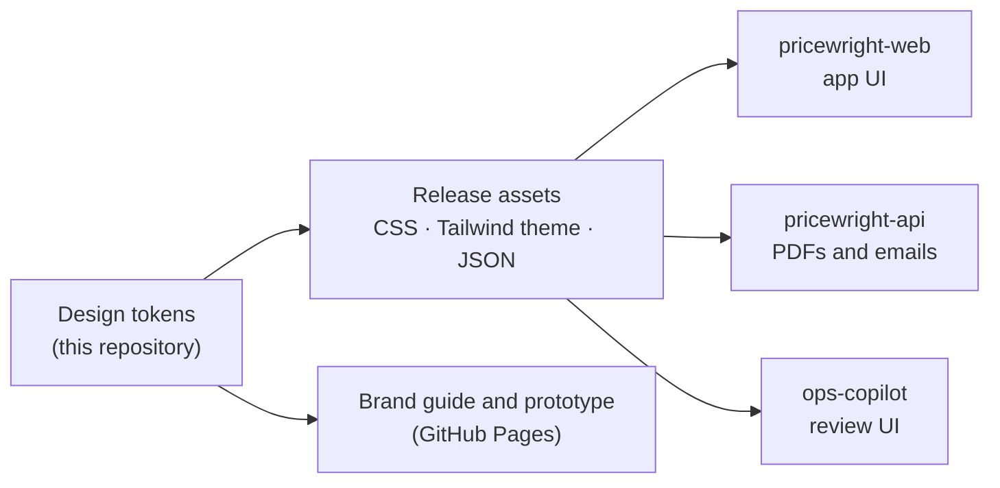

# Pricewright Design

> The brand, design tokens and UX research behind Pricewright: one source of truth for the web app,
> the quote PDFs and the emails.

[](https://github.com/odvprogra/pricewright-design/actions/workflows/ci.yml)
[](LICENSE)

Pricewright is a multi-tenant B2B quote-to-order platform:
[pricewright-api](https://github.com/odvprogra/pricewright-api) is its API. Every company in its
universe (Pricewright, Northfield Supply, Larkspur Tool Co.) is fictional.

## Demo

Work in progress (milestone M12). The brand guide and the clickable prototype will be published on
GitHub Pages from this repository.

## The problem

Pricewright reaches its users through several surfaces built in different repositories: a Next.js
web app, PDFs and emails rendered by a Python service, and an AI copilot's review screen. Without a
shared source, each one picks its own colors and sizes, they drift apart, and accessibility depends
on whoever touched the file last. Usability, too, is easy to assume and hard to prove once the app
exists.

## What it does

| Area                | Status      | What it delivers                                                                                                                  |
| ------------------- | ----------- | --------------------------------------------------------------------------------------------------------------------------------- |
| Brand guide         | In progress | Positioning, logo, palette with a contrast table, typography, iconography, voice                                                  |
| Design tokens       | Planned     | Semantic tokens with every contrast pair checked in CI (WCAG 2.2 AA)                                                              |
| Token builds        | Planned     | CSS custom properties, a Tailwind CSS theme and JSON on every immutable release                                                   |
| Journeys and specs  | Done        | [Journeys](docs/ux/journeys.md) per role and a [spec per screen](docs/ux/screens/README.md), with the four states and permissions |
| Clickable prototype | Planned     | The key screens on the tokens, with Northfield Supply's demo data                                                                 |
| Usability test      | Plan ready  | [Five participants](docs/ux/usability-test-1/plan.md): task success, time, errors, SEQ and SUS, and the changes it drove          |

The full scope is in the [brief](docs/brief.md).

## Architecture



Consumers pin a release, the same way they pin pricewright-api's `openapi.json`, so a design change
reaches each of them through a reviewed version bump.

## Key decisions

| Decision                                                 | Why                                                                             | ADR                                                                           |
| -------------------------------------------------------- | ------------------------------------------------------------------------------- | ----------------------------------------------------------------------------- |
| Design as code; tokens are the only source of a value    | Brand, prototype and products cannot drift (D-15)                               | [0001](docs/adr/0001-record-architecture-decisions.md)                        |
| A repository of its own; consumers pin a release         | Three consumers in two languages; none depends on another's repository          | [0002](docs/adr/0002-a-design-repository-consumed-through-pinned-releases.md) |
| Brand direction Ledger: navy, verdigris, serif documents | Quotations read as commercial documents; chosen among three explored directions | [0003](docs/adr/0003-the-ledger-brand-direction.md)                           |

## Run it locally

Prerequisites: Node.js 24 (with Corepack), Docker, [just](https://just.systems) and
[pre-commit](https://pre-commit.com).

```sh
just setup   # locked dependencies and git hooks
just check   # what CI checks
```

## Testing strategy

`just check` lints the workflows (actionlint), the formatting (Prettier) and the Markdown
(markdownlint). The token contrast tests arrive with the tokens.

## Project structure

```text
.
├── docs/
│   ├── adr/       # decisions, with context and alternatives
│   └── brief.md   # the milestone's scope and acceptance criteria
├── .github/       # CI, Dependabot, pull request and issue templates
├── justfile       # uniform commands
└── package.json   # pinned tooling (pnpm through Corepack)
```

## Trade-offs & what I'd do next

- The usability test runs on a prototype, not the shipped app: it finds flow and comprehension
  problems early, but not performance or data-volume ones. A second round on staging is planned for
  M8.
- Light theme only for now; the tokens are structured so dark mode is additive.

## License

[MIT](LICENSE)
